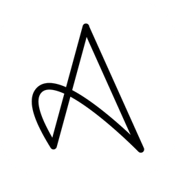
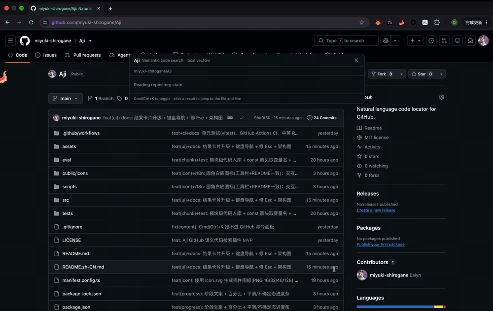
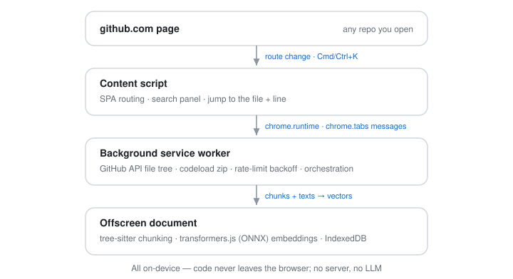

# Aji

**GitHub 语义代码检索 —— 浏览器内、本地向量。**

[English](./README.md) | 中文

在 github.com 上按 **Cmd/Ctrl+K**，用自然语言描述你要找的逻辑，直接跳到对应的函数/类与行号。

- **默认私密** —— 代码不离开浏览器；无服务端、不调 LLM、只读。
- **就在页面里** —— 活在 github.com 上，不用新标签页、不用看板。
- **增量索引** —— 只对新增/变更的文件重新向量化。
- **零配置** —— 任意公开仓库开箱即用，无需账号。

## 演示

这是一张 GIF；「建立索引」一段做了 <b>约 6× 加速</b>，实际会慢一些（首次主要是模型加载）。

## 快速开始

1. 从 [最新 Release](https://github.com/miyuki-shirogane/Aji/releases/latest) 下载 `aji-<version>.zip` 并解压。
2. 打开 `chrome://extensions`，开启「开发者模式」。
3. 点「**加载已解压的扩展程序**」→ 选择解压出的 `aji/` 文件夹。
4. （建议）扩展「选项」→ 填入 GitHub Personal Access Token（配额 60 → 5000 次/小时）。
5. 打开一个仓库，按 **Cmd/Ctrl+K** → 点「**Build index**」→ 等它跑完。
6. 输入 query（如 `how does it detect github page navigation`）回车，点结果跳到对应文件与行号。

## 工作原理

- **文件**：`git/trees?recursive=1`；源码用 `codeload` zip 一次拉全仓（不占 REST 配额）。
- **分块**：tree-sitter 取函数/类；超大函数切窗；无语法时回退定长分块。
- **向量**：`Xenova/all-MiniLM-L6-v2`（384 维，英文，WebGPU→WASM），按仓库存 IndexedDB；暴力余弦。
- **跳转**：`github.com/{o}/{r}/blob/{commit}/{path}#L{start}-L{end}`。

## 支持的语言

按 AST 分块（函数 / 类 / 方法 级）。语法**按需懒加载**，仓库里只有哪些语言才会加载哪些。

| 语言 | 扩展名 |
|---|---|
| Python | `.py` |
| JavaScript | `.js` `.jsx` `.mjs` `.cjs` |
| TypeScript / TSX | `.ts` `.tsx` |
| Go | `.go` |
| Rust | `.rs` |
| Java | `.java` |
| C | `.c` `.h` |
| C++ | `.cpp` `.cc` `.cxx` `.hpp` `.hh` `.hxx` |
| C# | `.cs` |
| PHP | `.php` |
| Kotlin | `.kt` `.kts` |
| Swift | `.swift` |
| Scala | `.scala` `.sc` |
| Shell | `.sh` `.bash` `.zsh` |
| Solidity | `.sol` |
| Zig | `.zig` |

新增一门语言很简单：在 `scripts/copy-assets.mjs` 里拷入它的语法 wasm，再扩展
`src/shared/const.ts` 的 `EXT_TO_LANG`、`GRAMMAR_FILES`、`NODE_TYPES`
（`tree-sitter-wasms` 内置 30+ 种语法）。

## 适用范围与限制

- 公开仓库、当前 ref、Chrome 116+。支持语言：见上。
- **增量索引**：仅对新增/变更文件重新向量化（按 blob sha 内容寻址）；测试/依赖/生成类文件自动跳过；有 GPU 时走 WebGPU。当前模型为**纯英文**（小、快）；如需中文，可在 `src/shared/const.ts` 换 `Xenova/multilingual-e5-small`（并加 `query:`/`passage:` 前缀），代价是向量化约慢一倍。
- 只做检索导航，不生成代码、不回答问题。

## 评测（参考性）

仅检索、无重排，英文模型；用例 30 条、单个小仓库、人工编写。复现：`npm run eval`。

| 指标 | 分数 |
|---|---|
| File Top-1 | ~67% |
| File Top-5 | ~90% |
| 函数(Symbol) Top-5 | ~73% |
| File MRR | ~0.77 |

局限：样本小、自建、单仓库，且"正确"只认某一个函数（会低估实用性——正确**文件**进前五约 90%）。同一配置多次运行会差 ±1 条（±3%）。**当参考信号看，不作竞争性宣称。**

## 帮助 Aji

Aji 免费开源。如果它对你有用，欢迎帮它变得更好：

- **给个 [Star](https://github.com/miyuki-shirogane/Aji) 并分享**，让更多人发现它。
- **[提 Bug / 需求](https://github.com/miyuki-shirogane/Aji/issues)** —— 告诉我缺什么（更多语言、更好的排序、私有仓库……）。
- **一起开发**：欢迎 PR，构建/测试/扩展见 [CONTRIBUTING.md](./CONTRIBUTING.md)。

## 许可证

MIT
